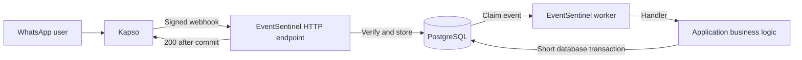

# EventSentinel

Receive Kapso WhatsApp webhooks safely and run application work with PostgreSQL.

## The order problem

1. A customer sends “buy 1 shirt” on WhatsApp.
2. Kapso sends the message to your webhook.
3. Your app stores an order.
4. The same webhook arrives again after a delivery retry.
5. The same message must not create a second order.
6. EventSentinel keeps one event and commits one local order.

## Kapso and EventSentinel

| Kapso already does                     | EventSentinel does                                     |
| -------------------------------------- | ------------------------------------------------------ |
| Delivers signed WhatsApp webhooks      | Checks the signature on the original bytes             |
| Supports batching and delivery retries | Stores each message before HTTP 200                    |
| Makes delivery ordering attempts       | Checks duplicates per message                          |
| Tracks delivery and endpoint health    | Runs stored work, retries failures and recovers leases |

## How it works



The HTTP request stores work. The worker reads that work later. See the [receive and retry diagram](docs/architecture.md#receive-retry-and-recover).

## Quick start

You need Node.js 22 or 24 LTS, npm and Docker Compose. Clone this repository and open its `event-sentinel` folder. No Kapso account or API key is needed for local mode.

```bash
npm ci
cp .env.example .env
docker compose up -d --wait
npm run db:migrate
npm run build
npm run example
```

The server listens on port 3000. It also starts one worker. `.env.example` has synthetic local values. Use them only for this demo.

In a second terminal, send a locally signed message:

```bash
npm run demo:single
npm run demo:orders
npm run demo:duplicates
npm run demo:orders
```

The sender signs the actual request bytes. The duplicate command sends the same message in parallel. The order count for that message stays one. Allow a short time for the worker to finish before reading orders.

Try a batch, then send one of its items again as a single message:

```bash
npm run demo:batch
npm run demo:batch-item
npm run demo:orders
```

On a fresh database, the single fixture and the two batch items produce three orders. Repeating these commands does not add more orders.

To see recovery, stop the server with Ctrl+C. Start the HTTP server with its worker turned off:

```bash
RUN_WORKER=false npm run example
```

In another terminal, send a new local benchmark message, then start the separate worker:

```bash
RUN_WORKER=false npm run bench
npm run example:worker
```

The benchmark uses new synthetic IDs, so it leaves pending work for this exercise. Stop and restart `example:worker` with Ctrl+C. Stored work remains in PostgreSQL. Use `npm run demo:orders` in a third terminal to see the results. In production, run the HTTP server and worker as separate processes against the same database.

## Usage

The package name `@your-scope/event-sentinel` is a **local placeholder**. This project is not published under that name. Build the repository before using its package self-import. Before publishing, choose your real scope and remove `private: true` from `package.json`.

The example below uses Fastify's buffer parser. It keeps the exact signed bytes. `ingest()` verifies the HMAC before parsing JSON.

```ts
import Fastify from 'fastify';
import pg from 'pg';
import {
  createEventSentinel,
  createPostgresStore,
} from '@your-scope/event-sentinel';

const pool = new pg.Pool({
  connectionString: process.env.DATABASE_URL,
  connectionTimeoutMillis: 3000,
  statement_timeout: 3000,
});
pool.on('error', () => {
  console.error('Idle database connection failed');
});
const sentinel = createEventSentinel({
  webhookSecret: process.env.KAPSO_WEBHOOK_SECRET!,
  phoneNumberId: process.env.KAPSO_PHONE_NUMBER_ID!,
  store: createPostgresStore(pool),
  onMessage: async (event, ctx) => {
    await ctx.transaction.query(
      `INSERT INTO orders (message_id, product, quantity)
       VALUES ($1, $2, $3) ON CONFLICT (message_id) DO NOTHING`,
      [event.message.id, 'shirt', 1],
    );
  },
});

const app = Fastify({ bodyLimit: 1024 * 1024 });
app.removeContentTypeParser('application/json');
app.addContentTypeParser(
  'application/json',
  { parseAs: 'buffer' },
  (_request, body, done) => done(null, body),
);
app.post<{ Body: Buffer }>('/webhooks/kapso', async (request, reply) => {
  const result = await sentinel.ingest({
    rawBody: request.body,
    headers: request.headers,
  });
  return reply.code(result.statusCode).send(result.body);
});

const worker = sentinel.startWorker();
await app.listen({ port: 3000, host: '127.0.0.1' });
```

Apply the library migration and [order schema](examples/orders/schema.sql) first. The pool must have a connection timeout from 1 to 3,000 ms. Keep a short statement timeout too. The full [example server](examples/orders/server.ts) also validates environment values and handles shutdown. Never use `JSON.stringify(request.body)` for signature checks.

Call `startWorker({ signal? })` once per sentinel. It returns a controller at once. To shut down, close the HTTP server, call `await worker.stop()`, then call `await pool.end()`. `worker.done` resolves when the worker loop ends. The default handler timeout is 5 seconds; shutdown allows 10 seconds. Keep handlers to short local SQL. The body limit is 1 MiB by default; set `maxBodyBytes` and the HTTP server's limit together if you change it.

## Batch handling

One webhook can hold many messages. A buffered batch can also hold just one. EventSentinel checks `batch` and `X-Webhook-Batch`, validates every item and stores the whole batch in one transaction.

Duplicates are checked per `(phone_number_id, event_type, message.id)`. A failed batch can later arrive as single messages without adding more jobs. An invalid item rejects the whole delivery. Unknown payload fields are kept. Origins are kept for your handler to decide how to use them.

## Real Kapso setup

1. Connect your WhatsApp number in Kapso. Copy its `phone_number_id`.
2. Create a **phone-number webhook**, with kind **Kapso**, event-based payload **v2**. Subscribe only to `whatsapp.message.received`. Project webhooks have a different scope.
3. Set its destination to your public HTTPS URL, ending in `/webhooks/kapso`.
4. Keep the webhook's secret key in `KAPSO_WEBHOOK_SECRET`. Use the exact secret shown or set in Kapso when you create the webhook. For API creation, set `secret_key` yourself and keep the same value locally.
5. Set `KAPSO_PHONE_NUMBER_ID` to the connected number's ID. Use your production `DATABASE_URL`, run migrations and start the receiver and worker.
6. Use Kapso's webhook delivery test, then send a message to the connected number. Check delivery in Kapso and the stored event in PostgreSQL.

For API registration, the route is `/platform/v1/whatsapp/phone_numbers/{phone_number_id}/webhooks`. Use `kind: "kapso"` and `payload_version: "v2"`. The local receiver needs the webhook secret, not a Kapso API key. A public tunnel can give a local server an HTTPS URL. See the [official setup guide](https://docs.kapso.ai/docs/platform/webhooks/overview) and [contract notes](docs/contract-notes.md).

## What happens on failures

**Database outage:** An accepted request cannot be stored, so the endpoint returns 503. Kapso can retry. EventSentinel never sends 200 for an uncommitted batch.

**Worker crash:** The event is already stored. A new worker can claim pending work or recover work after its lease ends. If the old transaction did not commit, its order is rolled back.

Invalid signatures get 401. Invalid payloads and unsupported event types get 400. Large bodies get 413; other content types get 415. After five failed attempts by default, the worker marks the event `dead`. See the [failure matrix](docs/failure-matrix.md).

## Guarantees and limits

- Work can run **at least once**. A handler can start again after a failure.
- Local business writes through `ctx.transaction` and event completion commit together. An expired worker cannot commit a conflicting local order.
- A saved message identity prevents another job. This is idempotency: **processing the same message again does not create another result**.
- External API calls can happen more than once. Keep them outside the open database transaction. Use stable operation IDs, a domain outbox or manual checks for uncertain results.
- Events have no strict conversation order. Keep identity rows for your retry and replay window. Deleting them removes duplicate protection.

This is not universal exactly-once execution. Read [the full guarantees](docs/guarantees.md) for lease checks, privacy, retention and monitoring SQL.

## Development

Start PostgreSQL before integration tests. They use a separate database and fail if it is not available.

```bash
npm run typecheck
npm run lint
npm test
npm run test:integration
npm run build
npm audit
```

With the example server running:

```bash
npm run bench
```

The benchmark sends signed synthetic requests. It reports measured success counts, new and duplicate events, and p50/p95 receive latency. It also prints the machine, event size, batch size, worker setting and database setup. These are local measurements, not a throughput promise. Record the actual number of running worker processes when you share results.

## Project status

This is a small MVP and an independent open-source project for Kapso developers. It is not an official Kapso product. Review its limits before using it in a live app.

License: [Apache-2.0](LICENSE).

- [Kapso webhook security](https://docs.kapso.ai/docs/platform/webhooks/security)
- [Kapso message events](https://docs.kapso.ai/docs/platform/webhooks/message-events)
- [Kapso delivery and batches](https://docs.kapso.ai/docs/platform/webhooks/advanced)
- [Architecture](docs/architecture.md) and [verified contract](docs/contract-notes.md)
- [Local verification results](docs/verification.md)
