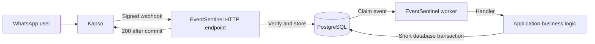
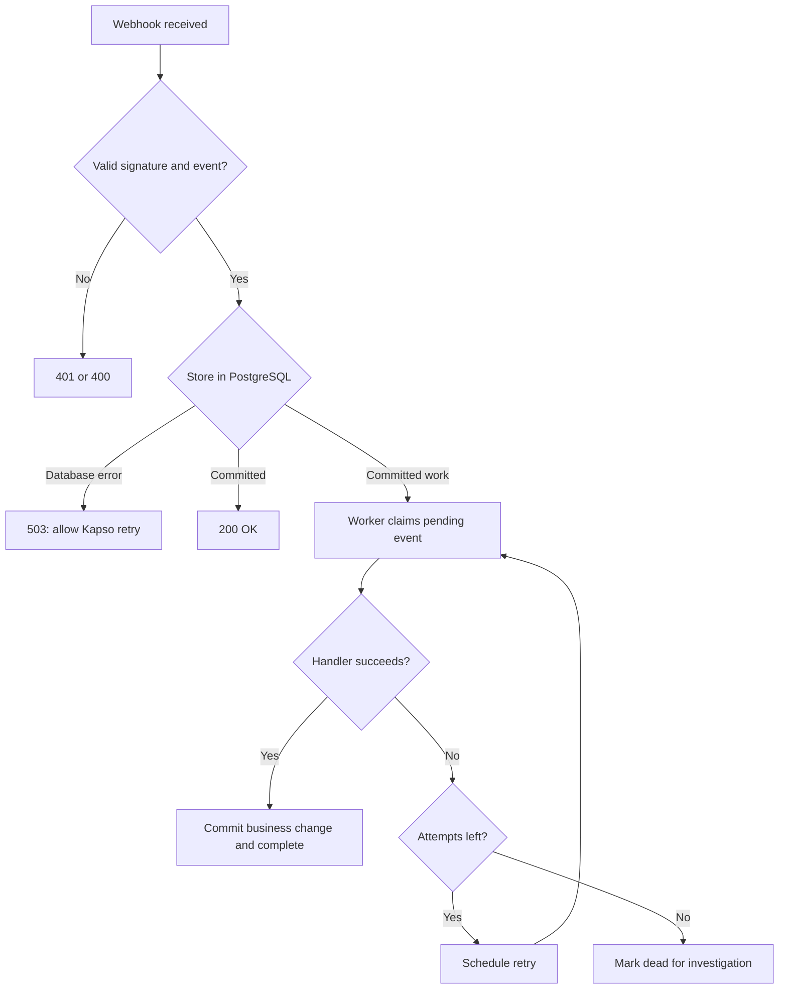

# Architecture

EventSentinel is one TypeScript package. PostgreSQL stores both events and pending work in `webhook_events`. There is no second queue to keep in sync.

## Where it fits

Kapso handles delivery to the HTTP endpoint. EventSentinel stores accepted messages and runs local application work. The worker reads committed rows. Sending the HTTP response does not schedule the worker.

## Receive, retry and recover

## Receive path

1. The HTTP adapter collects a bounded `Buffer` of the original body bytes.
2. `ingest()` checks content type, body size and raw-byte signature.
3. It parses JSON and validates the event and every batch item.
4. One database transaction inserts all new items in `pending` state. A unique constraint detects duplicates.
5. It commits, then returns 200. A database error returns 503.

The event identity is the configured phone-number ID, event type and message ID. Delivery keys do not replace this identity. The stored payload keeps unknown message and conversation fields. For a batch, each row keeps its item's payload; transport-only envelope data is not needed by the domain handler.

## Code boundaries

| Directory         | Responsibility                                    |
| ----------------- | ------------------------------------------------- |
| `src/kapso`       | Signature checks and v2 payload validation        |
| `src/core`        | Receive logic, handler types and worker lifecycle |
| `src/db`          | PostgreSQL transactions and queue queries         |
| `examples/orders` | Fastify adapter, local signing and order logic    |

The core does not receive Fastify request objects. The handler receives a typed message and a query interface for the current transaction.

The order handler makes a small local write. Keep this path short. Place slow computation and remote calls outside this transaction design. See [guarantees](guarantees.md) for lease handling, shutdown and external effects.
